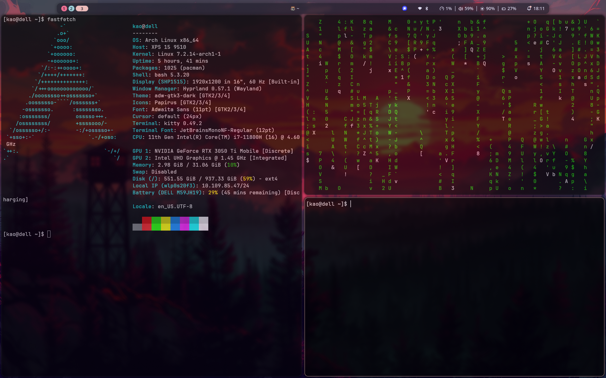

# dotfiles

My configs for Arch + Hyprland, with [Noctalia](https://noctalia.dev) as the shell (bar, launcher, notifications, lock screen, wallpaper).
Colors come from the Noctalia theme, which also generates the GTK and Hyprland border colors.


## Screenshot




## Usage

The simplest way is to use [GNU stow](https://www.gnu.org/software/stow/): 

```bash
stow -t ~ bash git gtk-3.0 gtk-4.0 hypr kitty noctalia
```
For `greetd` (the display manager, running the Noctalia Greeter), the files are
system files — copy them in manually, see [greetd/README.md](greetd/README.md).

You can also copy contents of each config manually, without using stow at all. 

All dependencies are in pkglist.txt. You can install them with yay: `yay -S --needed - < pkglist.txt`. Note, however, that they list ALL my essential packages. Regenerate the list with `./update_pkglist.sh`.
